# ADHD Detection
### EEG representation learning with a hybrid CNN–Vision Transformer and functional-connectivity fusion

  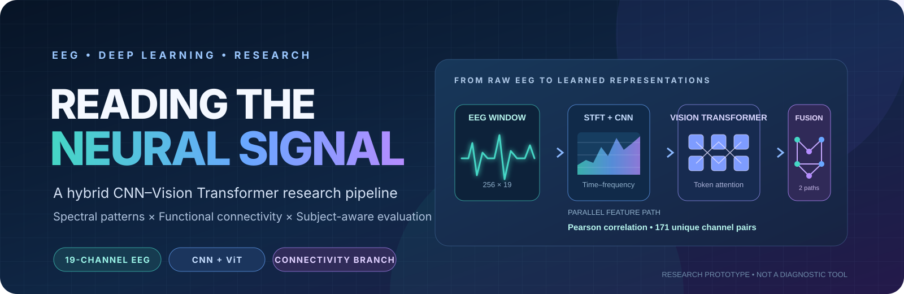

  
  
  
  
  

  <b>One EEG window. Two complementary representations. One research question.</b> 
  Can spectral-temporal patterns and inter-channel relationships provide complementary information for distinguishing ADHD and control recordings?

  <a href="#-the-project">Project</a> ·
  <a href="#-results-at-a-glance">Results</a> ·
  <a href="#-how-the-model-works">Architecture</a> ·
  <a href="#-visual-research-gallery">Gallery</a> ·
  <a href="#-reproduce-the-experiments">Reproduce</a> ·
  <a href="#-limitations--research-integrity">Limitations</a>

---

> [!CAUTION]
> **Research prototype — not a medical device.** This repository is for educational and experimental research. It is not clinically validated and must not be used to diagnose ADHD, rule out a diagnosis, recommend treatment, or make decisions about an individual. The reported metrics are results from the experiments stored here, not evidence of clinical readiness.

## 🧭 The project

This repository explores EEG-based ADHD-versus-control classification through a hybrid deep-learning pipeline. Rather than relying on a single representation of a signal, the principal experiment learns from two complementary views of each EEG window:

- **Spectral-temporal representation:** an on-graph Short-Time Fourier Transform (STFT), convolutional feature extraction and Vision Transformer (ViT) blocks.
- **Functional-connectivity representation:** Pearson correlations between EEG channels, encoded through a parallel dense branch.
- **Late feature fusion:** the two learned representations are combined before the final two-class prediction.
- **Participant-aware evaluation:** participant identities are preserved during splitting and prediction aggregation, enabling both window-level and participant-level reporting.

The central research notebook is **[sensitivitytestadhdcode.ipynb](sensitivitytestadhdcode.ipynb)**. Supporting methodology, pipeline notes, result reports and figures are included alongside it.

### What this repository contains

| Research component | What is present |
|---|---|
| EEG preprocessing | MNE-based filtering, channel montage handling, ICA/ICLabel artifact processing, normalization and window rejection |
| Hybrid model | TensorFlow/Keras STFT → CNN → ViT branch with a parallel Pearson-connectivity branch |
| Split strategy | Stratified, participant-grouped train/validation/test partitioning |
| Training | AdamW, categorical focal loss, deterministic seeds, validation-AUROC checkpoint selection |
| Evaluation | Window and participant metrics, ROC curves, confusion matrices and subject-cluster bootstrap intervals |
| Experiment analysis | Six additional saved metric reports and a hyperparameter sensitivity CSV |
| Explainability artefacts | Grad-CAM examples and ranked connectivity-feature visualizations |
| Earlier prototypes | An initial EEG ViT notebook and a separate experimental EEG–MRI fusion notebook |

**Scope clarification:** the main hybrid CNN–ViT pipeline and its baseline report are EEG-only. The repository also contains an earlier, separate EEG–MRI prototype; that exploratory notebook should not be conflated with the main model or described as a validated multimodal system.

## ✨ Why this approach?

EEG is a multichannel time series. The same recording can be examined from several useful perspectives:

| View | Representation | What the model can learn |
|---|---|---|
| Time–frequency | STFT magnitude features | How spectral energy changes over time and frequency |
| Local patterns | CNN feature maps | Local structure across spectral bins, frames and channels |
| Long-range relationships | Transformer self-attention | Interactions between learned spectrogram tokens |
| Channel relationships | Pearson correlation vector | Statistical coupling between pairs of EEG channels |
| Combined representation | Late fusion | Complementary information from spectral and connectivity branches |

These are modelling choices, not claims that any individual feature is a proven ADHD biomarker.

## 📈 Results at a glance

The values below are transcribed from **[final_evaluation_metrics_base.txt](final_evaluation_metrics_base.txt)**. They describe the saved baseline experiment; they were not independently rerun as part of this documentation update.

### Baseline held-out evaluation

| Metric | Window-level | Participant-level |
|---|---:|---:|
| Evaluation size | 1,000 windows | 18 participants |
| Class composition | 470 Control / 530 ADHD | 9 Control / 9 ADHD |
| **AUROC** | **0.9261** | **1.0000** |
| 95% subject-cluster bootstrap interval | 0.8506–0.9792 | 1.0000–1.0000 |
| **Accuracy at threshold 0.50** | **85.30%** | **100.00%** |
| Balanced accuracy | 85.35% | 100.00% |
| ADHD sensitivity | 84.53% | 100.00% |
| Control specificity | 86.17% | 100.00% |
| ADHD F1-score | 0.8591 | 1.0000 |
| Brier score | 0.1840 | 0.1800 |

**Window-level confusion matrix — threshold 0.50**

| Actual \ Predicted | Control | ADHD |
|---|---:|---:|
| Control | 405 | 65 |
| ADHD | 82 | 448 |

### Read the participant-level result responsibly

The participant-level prediction is produced by averaging a participant's window probabilities before classification. The held-out participant cohort contains only **18 people**. A perfect point estimate on this small cohort is statistically fragile and does not establish generalization to new populations, hospitals, EEG systems or acquisition protocols. The confidence interval, cohort size, split design and repeated experimentation all matter when interpreting the result.

### Saved experiment reports

The repository contains six additional reports. The numbered report files do not provide a sufficiently explicit, verified mapping to individual architectural changes, so they are identified by filename rather than assigned speculative ablation labels.

| Saved report | Window AUROC | Participant AUROC | Participant accuracy @ 0.50 |
|---|---:|---:|---:|
| [Baseline](final_evaluation_metrics_base.txt) | 0.9261 | 1.0000 | 100.00% |
| [Experiment 1](final_evaluation_metrics_ablation1.txt) | 0.7384 | 0.8519 | 72.22% |
| [Experiment 2](final_evaluation_metrics_ablation2.txt) | 0.9127 | 0.9877 | 88.89% |
| [Experiment 3](final_evaluation_metrics_ablation3.txt) | 0.9281 | 0.9630 | 83.33% |
| [Experiment 4](final_evaluation_metrics_ablation4.txt) | 0.9037 | 1.0000 | 83.33% |
| [Experiment 5](final_evaluation_metrics_ablation5.txt) | 0.6559 | 0.7407 | 61.11% |
| [Experiment 6](final_evaluation_metrics_ablation6.txt) | 0.9317 | 1.0000 | 88.89% |

The variation across runs is important: a single best-looking number is not enough to select a model. The exact configuration, validation-only selection process, uncertainty and untouched external evaluation must be considered.

### Hyperparameter sensitivity

**[sensitivity_analysis_results.csv](sensitivity_analysis_results.csv)** contains a structured sweep across four dimensions:

- Focal-loss focusing parameter — FOCAL_GAMMA
- Transformer depth — VIT_BLOCKS
- Transformer dropout — VIT_DROPOUT
- AdamW weight decay — WEIGHT_DECAY

It records best epoch, training time, peak validation metrics and window-/participant-level test metrics. The saved panels are shown in the [visual gallery](#-visual-research-gallery).

> **Evaluation discipline:** because multiple configurations were evaluated on the same held-out cohort, those test-set comparisons are exploratory. Use training and validation data for model selection; reserve a genuinely untouched external cohort for final performance claims.

## 🧹 EEG processing pipeline

The main notebook configures 19 EEG channels, a sampling frequency of 128 Hz and fixed windows of 256 samples (2 seconds).

| Stage | Main notebook configuration |
|---|---|
| Input | Subject-level MATLAB .mat recordings |
| Channels | 19 EEG channels; standard 10–20 montage |
| Legacy channel labels | T3→T7, T4→T8, T5→P7, T6→P8 |
| Voltage scaling | Multiply by 1e-7 |
| Bad-channel handling | Low-variance/flatline detection and interpolation |
| Band-pass filter | FIR, 1–40 Hz |
| Reference | Common average reference (CAR) |
| Artifact processing | Extended Infomax ICA with ICLabel-assisted component identification |
| Component exclusion | Selected ocular, cardiac and muscle labels above the configured 0.70 probability threshold |
| Window length | 256 samples / 2 seconds |
| Training overlap | 50% in the current main notebook configuration |
| Test overlap | 0% |
| Amplitude rejection | Reject a window if any absolute sample exceeds 150 µV |
| Normalization | Subject-specific channel-wise z-scoring using the implemented clean-window procedure |

### Participant-isolated data splitting

The main notebook uses StratifiedGroupKFold(n_splits=7, shuffle=True, random_state=42):

- Five folds are combined for training.
- One fold is used for validation.
- One fold is reserved for testing.
- Explicit set-intersection checks verify that participant IDs do not overlap between partitions.
- Dataset integrity assertions check the expected total of 121 unique subject identities.

This matters because EEG windows from the same participant are correlated. Randomly splitting windows can put near-related segments from one person into both training and test sets and overstate generalization.

### A note on normalization

The implemented subject-specific z-score procedure uses statistics derived from that participant's recording. This is a retrospective normalization choice, not necessarily a causal online procedure. A prospective or real-time system would need a separately specified normalization strategy that uses only information available at the time of prediction.

## 🧠 How the model works

The principal model has two parallel input branches and a late-fusion classifier.

\`\`\`mermaid
flowchart LR
    A["EEG window 256 × 19"] --> B["GPU STFT 128 frame · 8 step · 128 FFT"]
    B --> C["Log magnitude 41 frequency bins"]
    C --> D["CNN feature extractor"]
    D --> E["Patch projection 40 tokens × 64"]
    E --> F["Positional embedding"]
    F --> G["3 Transformer encoder blocks"]
    G --> H["Global average pooling 64 features"]

    A --> I["Pearson channel correlations"]
    I --> J["Upper triangle 171 features"]
    J --> K["Dense connectivity encoder 32 features"]

    H --> L["Concatenate 96 features"]
    K --> L
    L --> M["Dense + GELU + Dropout"]
    M --> N["Softmax"]
    N --> O["Control / ADHD"]
\`\`\`

### Branch A — spectral CNN–ViT

1. **GPU STFT:** computes the short-time Fourier transform inside the TensorFlow model graph.
2. **Frequency selection:** retains 41 bins spanning 0–40 Hz and applies logarithmic magnitude compression.
3. **CNN blocks:** factorized temporal/spatial convolution followed by additional convolutional blocks. Pooling compresses frequency resolution while preserving the temporal-frame dimension.
4. **Patch projection:** projects the final feature map into a 5 × 8 grid — 40 tokens of dimension 64 in the documented configuration.
5. **Positional encoding:** adds learned positional embeddings to the token sequence.
6. **Transformer encoder:** applies three pre-normalized encoder blocks with four attention heads, residual connections, LayerScale and GELU feed-forward layers.
7. **Pooling:** global average pooling produces the spectral feature vector.

### Branch B — functional connectivity

For each clean EEG window, the pipeline computes the Pearson correlation between every pair of the 19 channels. The upper triangle excludes the diagonal and duplicate symmetric entries:

**19 × 18 / 2 = 171 unique pairwise features.**

A dense encoder maps the 171-dimensional vector to a 32-dimensional learned representation. The connectivity features are computed from the original clean window; they are not intended to be inferred from an artifact-mixed waveform.

### Fusion head

The 64-dimensional pooled spectral representation and 32-dimensional connectivity representation are concatenated into a 96-dimensional vector. A dense layer, GELU activation, dropout and two-class softmax produce the model output.

### Main notebook configuration

| Parameter | Value |
|---|---:|
| Input window | 256 × 19 |
| Connectivity vector | 171 |
| STFT frame length | 128 |
| STFT frame step | 8 |
| FFT length | 128 |
| Retained frequency bins | 41 |
| ViT embedding dimension | 64 |
| ViT blocks | 3 |
| Attention heads | 4 |
| Batch size | 64 |
| Epoch budget | 20 |
| Optimizer | AdamW |
| Learning rate | 1e-4 |
| Weight decay | 1e-2 |
| Gradient clip norm | 1.0 |
| Focal-loss gamma | 2.0 |
| Random seed | 42 |
| Mixup | Disabled in the main notebook configuration |

The experiment notebook is the source of truth for the configuration used by that notebook. Some supporting notes preserve earlier settings; see [reproducibility notes](#-reproducibility-and-version-notes).

## 🔍 Evaluation methodology

The saved evaluation pipeline reports:

- Accuracy and balanced accuracy
- ADHD sensitivity and Control specificity
- Precision, negative predictive value and F1-score
- Matthews correlation coefficient and Cohen's kappa
- AUROC and ROC curves
- Brier score
- Confusion matrices
- Window-level and participant-level metrics
- Subject-cluster bootstrap confidence intervals (1,000 resamples in the documented evaluation code)

### Why both window and participant metrics?

**Window-level:** evaluates independent 2-second test windows. These are segments, not independent people.

**Participant-level:** groups predictions by participant and averages ADHD probabilities before evaluation. This better aligns the unit of analysis with a participant-level research question, but the held-out cohort remains small.

The baseline's default classification metrics use a fixed threshold of 0.50. Some saved reports also contain a second ROC-derived operating point described as a high-sensitivity or triage regime. That is an exploratory, post-hoc operating point—not a prevalidated clinical threshold.

## 🖼️ Visual research gallery

All figures below are committed repository assets and are linked locally, so they remain available when the repository is cloned.

### Evaluation

<table>
  <tr>
    <td width="50%">
      <a href="confusion_matrices.png">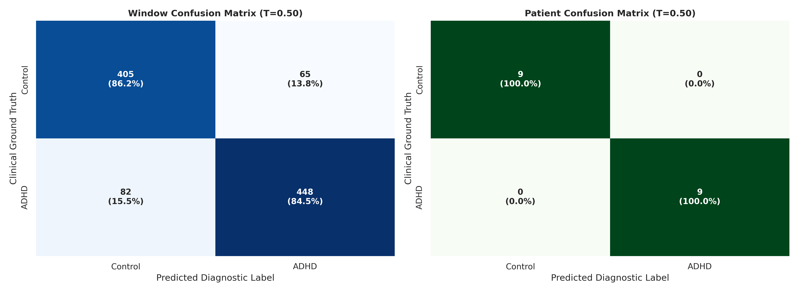</a>
      
<b>Confusion matrices</b> Window and participant predictions at the default threshold.

    </td>
    <td width="50%">
      <a href="roc_curves.png">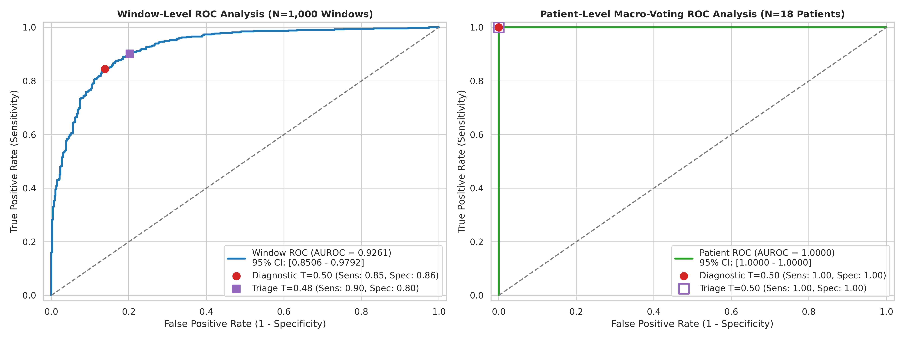</a>
      
<b>ROC analysis</b> Discrimination performance with reported bootstrap intervals.

    </td>
  </tr>
</table>

### Training and parameter exploration

<table>
  <tr>
    <td width="50%">
      <a href="training_dynamics.png">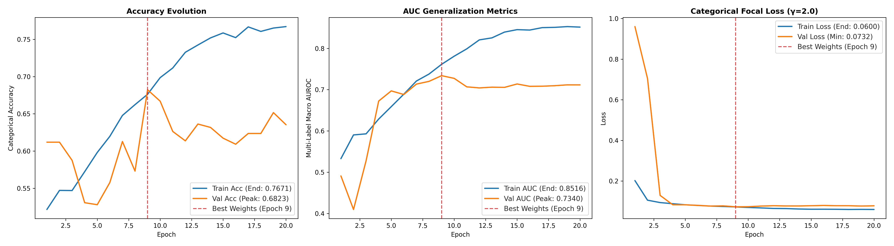</a>
      
<b>Training dynamics</b>

    </td>
    <td width="50%">
      <a href="sensitivity_analysis_panels.png">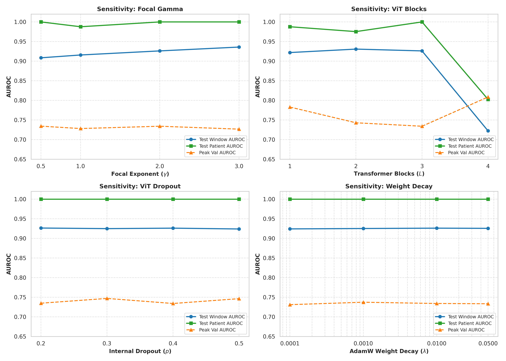</a>
      
<b>Sensitivity analysis</b>

    </td>
  </tr>
</table>

### Signal examples and connectivity

<table>
  <tr>
    <td width="50%">
      <a href="final_model_input_ADHD_v14p.png">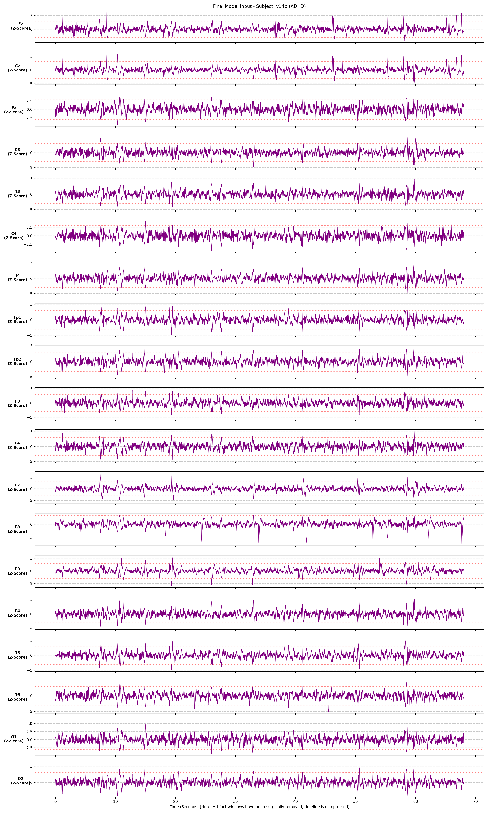</a>
      
<b>ADHD-labelled EEG example</b>

    </td>
    <td width="50%">
      <a href="final_model_input_Control_v107.png">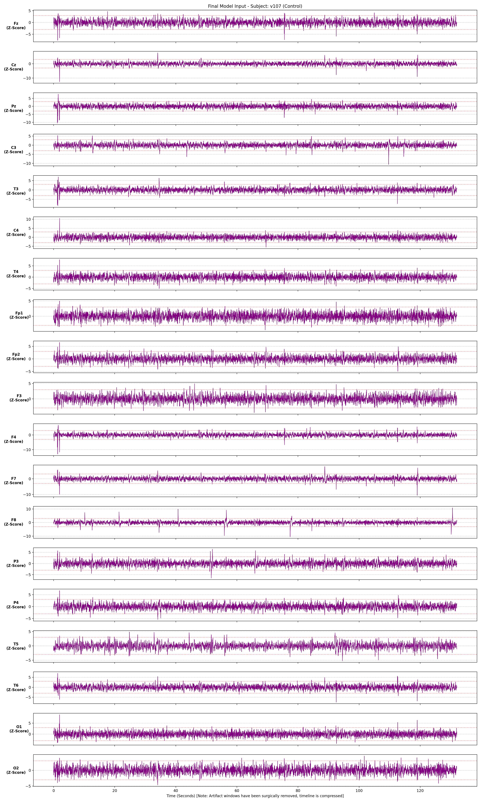</a>
      
<b>Control-labelled EEG example</b>

    </td>
  </tr>
</table>

  <a href="top10_connectivity_biomarkers.png">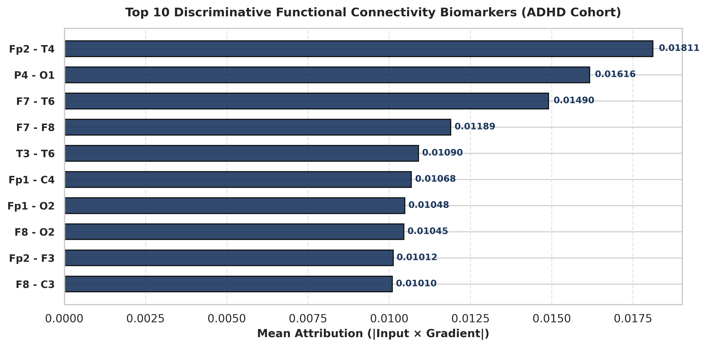</a> 
  <b>Top-ranked connectivity features</b> 
  Model-derived feature rankings; not clinically validated biomarkers.

### Grad-CAM examples

<table>
  <tr>
    <td width="50%">
      <a href="gradcam_adhd_individual.png">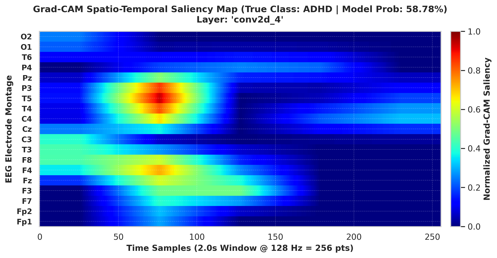</a>
      
<b>ADHD-labelled example</b>

    </td>
    <td width="50%">
      <a href="gradcam_control_individual.png">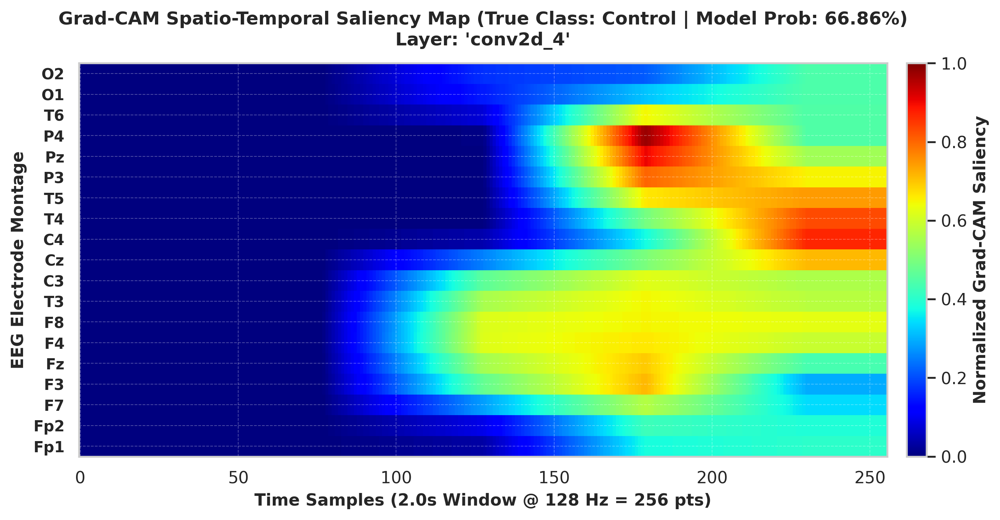</a>
      
<b>Control-labelled example</b>

    </td>
  </tr>
</table>

  <a href="gradcam_adhd_vs_control_comparison.png">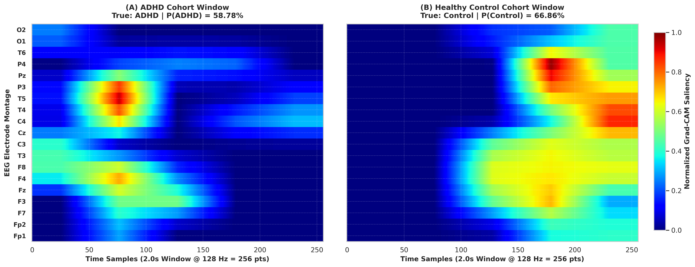</a> 
  <b>Grad-CAM comparison</b>

Grad-CAM highlights regions that influence a particular model output. It does not establish causality, reveal a definitive disease location, or validate a physiological biomarker.

## 🗂️ Repository map

| File | Purpose |
|---|---|
| [sensitivitytestadhdcode.ipynb](sensitivitytestadhdcode.ipynb) | Main EEG hybrid CNN–ViT experiment, sensitivity sweep and detailed evaluation |
| [ADHD_MINI_PROJECT.ipynb](ADHD_MINI_PROJECT.ipynb) | Earlier EEG preprocessing and ViT prototype |
| [Copy_of_ADHD_MINI_PROJECT.ipynb](Copy_of_ADHD_MINI_PROJECT.ipynb) | Separate exploratory EEG–MRI/PyTorch fusion prototype |
| [adhd paper notebook.ipynb](%20adhd%20paper%20notebook.ipynb) | Additional research notebook |
| [notebook18c25b8789 (1).ipynb](notebook18c25b8789%20%281%29.ipynb) | Additional archived notebook experiment |
| [methodology notes.md](methodology%20notes.md) | Detailed preprocessing, modelling and evaluation decisions |
| [pipeline.md](pipeline.md) | Pipeline overview; contains some historical settings |
| [defense notes.md](defense%20notes.md) | Research discussion and methodological caveats |
| [adhd_proj_desc.docx.md](adhd_proj_desc.docx.md) | Project background and written description |
| [sensitivity_analysis_results.csv](sensitivity_analysis_results.csv) | Hyperparameter sweep results |
| [adhd_ablations_new.xlsx](adhd_ablations_new.xlsx) | Experiment/ablation workbook |
| [final_evaluation_metrics_base.txt](final_evaluation_metrics_base.txt) | Baseline evaluation report |
| [final_evaluation_metrics_ablation1.txt](final_evaluation_metrics_ablation1.txt) – [ablation6](final_evaluation_metrics_ablation6.txt) | Additional saved evaluation reports |
| [requirements.txt](requirements.txt) | Minimal declared Python application dependencies |
| [LICENSE](LICENSE) | MIT License |

The root also contains the committed figures shown in the gallery and launcher-related files. Notebooks represent different stages of development; do not assume they share the same dataset, framework, preprocessing or model.

## 🚀 Reproduce the experiments

### 1. Clone the repository

    git clone https://github.com/RITESH2127/ADHD-DETECTION.git
    cd ADHD-DETECTION

### 2. Create the Python environment

The repository's .python-version file specifies **Python 3.10.13**.

**Windows PowerShell**

    py -3.10 -m venv .venv
    .venv\Scripts\Activate.ps1
    python -m pip install --upgrade pip

**macOS / Linux**

    python3.10 -m venv .venv
    source .venv/bin/activate
    python -m pip install --upgrade pip

### 3. Install research dependencies

The committed requirements.txt is a short dependency list and is **not a complete, version-locked environment for the main research notebook**. The main notebook imports additional packages.

A starting installation for the documented EEG notebook is:

    pip install tensorflow-cpu numpy scipy pandas scikit-learn mne mne-icalabel matplotlib seaborn tqdm

For GPU execution, install a TensorFlow build compatible with your operating system, Python version, accelerator and driver stack. GPU support is environment-specific; the notebook's use of TensorFlow operations does not guarantee that a compatible GPU is available.

### 4. Configure the EEG dataset

The raw participant recordings are **not included** in this repository. The main notebook's Config.DATA_DIR and Config.PREPROC_CACHE_DIR point to Kaggle-mounted input directories. Before running it:

1. Obtain the dataset through its authorized source and review its terms of use.
2. Place or mount the expected subject-level data in your environment.
3. Update Config.DATA_DIR and Config.PREPROC_CACHE_DIR to valid local paths.
4. Confirm that the expected MATLAB files, labels and internal data structure match the notebook's loader.
5. Keep identifiable or restricted participant data outside the Git repository.

### 5. Run the main notebook

Open [sensitivitytestadhdcode.ipynb](sensitivitytestadhdcode.ipynb) in Jupyter Notebook, JupyterLab or a compatible hosted notebook environment. Run cells in order after configuring the dataset paths and dependencies.

The notebook sets deterministic seeds and creates output directories for logs, model weights and plots. Re-running the full training and sensitivity experiments can require substantial compute time and memory.

### Application / Streamlit status

The repository includes run_app.bat and a file named app.py, but the current contents of app.py are notebook-format JSON rather than a conventional Streamlit Python script. Therefore, the Streamlit launcher is **not documented as a verified working demo**. The supported research entry point described here is the main Jupyter notebook. The application entry point should be corrected and tested before advertising a runnable web demo.

## 🧪 Reproducibility and version notes

A few repository files preserve different stages of experimentation. To avoid silently mixing configurations:

| Setting | Main notebook currently specifies | Historical note |
|---|---:|---|
| Training window overlap | 50% | Some pipeline notes state 85% |
| Epoch budget | 20 | Some notes mention 50–60 epochs |
| Mixup | Disabled | Notes describe optional/curriculum Mixup experiments |
| Test window overlap | 0% | Consistent across the documented pipeline |

When reproducing the saved main experiment, follow the configuration in [sensitivitytestadhdcode.ipynb](sensitivitytestadhdcode.ipynb), not older prose values in supporting notes. Record the notebook revision, dataset version, preprocessing cache signature, split seed and model configuration alongside any new result.

The saved baseline report is a result artefact; it does not guarantee that a fresh run will reproduce identical metrics under a different package stack, hardware backend, data version or preprocessing cache.

## ⚖️ Limitations & research integrity

This project has meaningful engineering and research components, but its current evidence has clear limits:

1. **Small participant test set:** the baseline report evaluates 18 held-out participants. Thousands of windows do not create thousands of independent participants.
2. **No external validation is demonstrated in the saved reports:** performance on one split does not establish generalization across sites, populations, recording devices or acquisition protocols.
3. **Repeated test-set inspection:** sensitivity and experiment reports include results on the same held-out cohort. Repeatedly consulting those metrics can bias model selection.
4. **Normalization assumptions:** full-recording subject statistics are not automatically suitable for prospective or real-time prediction.
5. **Dataset provenance:** raw EEG/MRI data are not included. Dataset versions, access conditions and licensing must be checked at their original sources.
6. **Separate prototype tracks:** the EEG–MRI notebook is exploratory and is not the same as the main EEG-only hybrid model.
7. **Explainability limits:** Grad-CAM and connectivity rankings are descriptive model-analysis tools, not proof of causality or clinical biomarkers.
8. **No clinical validation:** there is no evidence here of clinical utility, prospective safety, regulatory approval or suitability for patient care.

### What stronger evidence would look like

- Nested and repeated participant-grouped cross-validation.
- A locked model and a fully untouched external test cohort.
- Larger, diverse, multi-site participant cohorts.
- Pre-registered analysis and a documented experiment-to-configuration mapping.
- Calibration, uncertainty, subgroup and dataset-shift evaluation.
- Prospective normalization and inference tests.
- Robustness checks for artifacts, missing channels and acquisition differences.
- Explanation stability analysis before making biomarker-related claims.

## 🛠️ Technology

| Layer | Tools |
|---|---|
| Language | Python 3.10.13 |
| Deep learning | TensorFlow / Keras |
| EEG processing | MNE, mne-icalabel, SciPy |
| Data and numerical work | NumPy, pandas |
| Evaluation | scikit-learn |
| Visualization | Matplotlib, seaborn |
| Experiment environment | Jupyter Notebook; Kaggle-mounted dataset paths |
| Additional prototypes | PyTorch, nibabel and Grad-CAM-related tooling in the separate multimodal notebook |

## 📖 Citation

If you use or extend this work, cite the repository and report the exact dataset, preprocessing, participant split, model configuration and evaluation protocol used.

    @software{kumar_adhd_eeg_hybrid,
      author  = {Ritesh Kumar},
      title   = {ADHD Detection: EEG Hybrid CNN--Vision Transformer Research},
      year    = {2026},
      url     = {https://github.com/RITESH2127/ADHD-DETECTION},
      license = {MIT}
    }

## 📜 License

Distributed under the [MIT License](LICENSE). The repository license applies to this code; it does not grant rights to third-party datasets or other external resources.

---

  <b>Ritesh Kumar</b> 
  Computer Science & Engineering
    
  <a href="https://github.com/RITESH2127">GitHub Profile</a> ·
  <a href="https://github.com/RITESH2127/ADHD-DETECTION">ADHD Detection Repository</a>
    
  Build carefully. Evaluate honestly. Make the science reproducible.

