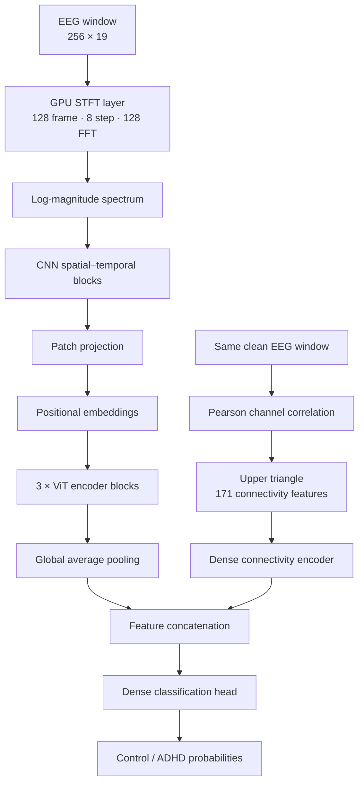

# ADHD Detection
### An EEG-based hybrid CNN–Vision Transformer with functional-connectivity learning and subject-level evaluation

<p align="center">
  
  
  
  
  
</p>

<p align="center">
  <b>From cleaned neural signals to interpretable model experiments.</b><br/>
  A research codebase exploring ADHD-versus-control classification from EEG using time–frequency representations, a convolutional front end, Vision Transformer blocks, and a parallel functional-connectivity branch.
</p>

<p align="center">
  <a href="#-at-a-glance">At a glance</a> ·
  <a href="#-research-results">Results</a> ·
  <a href="#-signal-processing">Signal processing</a> ·
  <a href="#-model-architecture">Architecture</a> ·
  <a href="#-visual-results">Visual results</a> ·
  <a href="#-reproduce-the-work">Reproduce</a> ·
  <a href="#-limitations-and-responsible-use">Limitations</a>
</p>

---

> **Research-use notice**  
> This repository is an experimental machine-learning project, not a medical device or clinically validated diagnostic system. Its predictions must not be used to diagnose ADHD, rule it out, select treatment, or make decisions about a person. The reported results are internal experimental results on a small held-out cohort and require independent replication.

## 🧠 At a glance

ADHD is heterogeneous: no single EEG pattern is sufficient to describe every individual. This project investigates whether complementary representations of scalp electrical activity can be learned together:

- **Time–frequency structure** — short-time Fourier transform (STFT) features expose how spectral energy changes over time and across electrodes.
- **Local spatial–temporal patterns** — convolutional layers learn compact patterns from the EEG spectrogram.
- **Long-range token relationships** — Vision Transformer (ViT) encoder blocks model interactions across the spectrogram token sequence.
- **Functional connectivity** — pairwise Pearson correlations provide a second representation of relationships between EEG channels.
- **Subject-aware evaluation** — participant IDs are retained through splitting and prediction aggregation, so evaluation can be reported at both window and participant level.

The current main experimental pipeline is **EEG-based**. Although MRI and multimodal EEG–MRI ideas appear in broader project planning material, the executable hybrid model documented here takes EEG windows and EEG-derived connectivity features as inputs; it should not be described as a validated EEG+MRI fusion model.

### What is in this repository?

| Area | Included material |
|---|---|
| Research notebooks | EEG preprocessing, model development, evaluation and sensitivity experiments |
| Signal processing | MNE-based filtering, referencing, ICA/ICLabel artifact handling, normalization and windowing |
| Model | TensorFlow/Keras STFT → CNN → ViT branch plus Pearson-connectivity branch |
| Evaluation | Window-level and participant-level metrics, ROC curves, confusion matrices and cluster-bootstrap intervals |
| Experiments | Baseline metrics, six experiment metric reports, parameter sensitivity CSV and ablation workbook |
| Visual analysis | Training dynamics, sensitivity panels, Grad-CAM images, input examples and connectivity ranking |
| Demo | Streamlit application in `app.py` |

## 📊 Research results

The repository's `final_evaluation_metrics_base.txt` reports the following baseline run. These values are reproduced here as stored in the repository, not independently rerun during this README update.

### Baseline — held-out evaluation

| Metric | Window level | Participant level |
|---|---:|---:|
| Evaluation samples | 1,000 windows | 18 participants |
| Class composition | 470 Control / 530 ADHD | 9 Control / 9 ADHD |
| AUROC | **0.9261** | **1.0000** |
| 95% cluster-bootstrap interval | 0.8506–0.9792 | 1.0000–1.0000 |
| Accuracy at threshold 0.50 | **85.30%** | **100.00%** |
| Balanced accuracy | 85.35% | 100.00% |
| ADHD sensitivity | 84.53% | 100.00% |
| Control specificity | 86.17% | 100.00% |
| ADHD F1-score | 0.8591 | 1.0000 |
| Brier score | 0.1840 | 0.1800 |

**Window-level confusion matrix (threshold = 0.50):**

|  | Predicted Control | Predicted ADHD |
|---|---:|---:|
| Actual Control | 405 | 65 |
| Actual ADHD | 82 | 448 |

The participant-level score is based on averaging each participant's window probabilities (macro soft-voting) before classification. It is based on **18 participants only**. A perfect score on such a small cohort is highly uncertain and must not be interpreted as evidence of clinical-level accuracy or broad generalization. The confidence interval and cohort size should be read alongside the point estimate.

### Experiment reports

The repository also contains six files named `final_evaluation_metrics_ablation1.txt` through `final_evaluation_metrics_ablation6.txt`. The table below summarizes their reported AUROCs and fixed-threshold participant accuracy. The experiment files do not, by themselves, provide a sufficiently explicit mapping from every numbered run to a named architectural component; therefore, these are labelled by report filename rather than assigning unverified meanings to them.

| Report | Window AUROC | Participant AUROC | Participant accuracy @ 0.50 |
|---|---:|---:|---:|
| Baseline | 0.9261 | 1.0000 | 100.00% |
| Ablation 1 | 0.7384 | 0.8519 | 72.22% |
| Ablation 2 | 0.9127 | 0.9877 | 88.89% |
| Ablation 3 | 0.9281 | 0.9630 | 83.33% |
| Ablation 4 | 0.9037 | 1.0000 | 83.33% |
| Ablation 5 | 0.6559 | 0.7407 | 61.11% |
| Ablation 6 | 0.9317 | 1.0000 | 88.89% |

These runs show that results vary materially across experimental configurations. The highest reported AUROC is not, on its own, a model-selection rule: comparisons should account for the exact configuration, validation-only selection, participant-level uncertainty, and repeated experimentation on the same held-out cohort.

### Hyperparameter sensitivity

The committed `sensitivity_analysis_results.csv` records sweeps over:

- Focal-loss focusing parameter (`FOCAL_GAMMA`)
- Number of ViT blocks (`VIT_BLOCKS`)
- ViT dropout (`VIT_DROPOUT`)
- AdamW weight decay (`WEIGHT_DECAY`)

The CSV includes training time, best epoch, peak validation AUROC/accuracy/loss, and window- and participant-level test metrics. The plots below visualize these experiments. Because many settings are compared against the same test cohort, test-set sensitivity results are descriptive rather than an unbiased basis for further tuning.

## 🧹 Signal processing

The main experimental notebook documents a 19-channel EEG pipeline. Its configured sampling frequency is 128 Hz, and the model operates on 2-second windows (256 samples).

| Stage | Implementation recorded in the notebook |
|---|---|
| Input | Subject-level MATLAB `.mat` recordings |
| Channel layout | 19 EEG channels using a standard 10–20 montage |
| Channel naming | Legacy temporal labels remapped to standard montage names |
| Voltage scaling | Signal multiplied by `1e-7` |
| Bad-channel handling | Low-variance/flatline screening and interpolation |
| Filtering | FIR band-pass, 1–40 Hz |
| Referencing | Common average reference (CAR) |
| Artifact handling | Extended Infomax ICA with ICLabel-assisted component identification; selected ocular, cardiac and muscle components excluded above the configured 0.70 confidence threshold |
| Normalization | Subject-specific channel-wise z-score procedure with a clean-window pre-scan and fallback |
| Windowing | 256 samples per window; configured train overlap 50%, test overlap 0% |
| Amplitude rejection | Window rejected if any absolute voltage sample exceeds 150 µV |

The notebook includes deterministic seeds, preprocessing-parameter fingerprinting for cached data, integrity checks for subject IDs, and explicit train/validation/test group-intersection checks.

### Participant-disjoint split

The documented split uses `StratifiedGroupKFold(n_splits=7, shuffle=True, random_state=42)`: five folds are combined for training, one fold is used for validation, and one fold for testing. The code checks that subject IDs do not overlap between these partitions.

This is an important safeguard against a common EEG evaluation error: randomly splitting overlapping windows can place data from the same participant in both training and test sets, inflating apparent performance.

**Important methodological nuance:** subject-wise z-scoring uses statistics computed from that participant's recording. For a retrospective benchmark this can be a deliberate normalization choice, but it uses information across the recording rather than a strictly causal streaming window. A real-time or prospective use case would need a separately defined normalization protocol fitted only from information available at inference time.

## 🏗️ Model architecture

The main hybrid model is implemented in TensorFlow/Keras. It has two parallel EEG-derived input branches.



### Branch A — spectral CNN–ViT

1. **GPU STFT layer:** computes the short-time Fourier transform inside the TensorFlow graph; the configured frame length is 128, frame step is 8, and FFT length is 128.
2. **Spectral compression:** converts magnitudes to a logarithmic decibel-like scale and retains the first 41 frequency bins (0–40 Hz).
3. **CNN feature extraction:** factorized temporal and spatial convolution in the first block, followed by convolutional blocks with frequency-focused pooling and spatial dropout.
4. **Patch projection:** maps the final feature map to a sequence of 40 tokens, each with a 64-dimensional embedding in the documented baseline configuration.
5. **Transformer encoding:** adds learned positional embeddings and applies three pre-normalized Transformer encoder blocks with four attention heads, residual connections, LayerScale and GELU feed-forward layers.
6. **Pooling:** global average pooling produces the spectral representation.

### Branch B — functional connectivity

For each clean EEG window, Pearson correlations are computed between the 19 channels. The 171 unique off-diagonal values from the upper triangle form a compact connectivity vector. A small dense network projects this vector into a learned feature representation.

### Fusion and classifier

The pooled ViT representation and connectivity embedding are concatenated and passed through a dense classification head with dropout and a two-class softmax output.

### Training configuration (documented baseline)

| Setting | Value |
|---|---:|
| Window shape | 256 × 19 |
| Connectivity features | 171 |
| STFT frame / step / FFT | 128 / 8 / 128 |
| Retained frequency bins | 41 (0–40 Hz) |
| ViT embedding dimension | 64 |
| ViT encoder blocks | 3 |
| Attention heads | 4 |
| Batch size | 64 |
| Learning rate | 1e-4 |
| AdamW weight decay | 1e-2 |
| Gradient clipping | 1.0 |
| Focal-loss gamma | 2.0 |
| Random seed | 42 |
| Mixup | Disabled in the committed baseline configuration |

The sensitivity notebook and supporting notes contain experimental settings that have changed over time. When reproducing a run, treat the actual notebook configuration and the corresponding saved metric report as authoritative rather than assuming every historical note describes the current baseline.

## 🔬 Evaluation and statistical reporting

The project reports more than a single accuracy number:

- Accuracy and balanced accuracy
- ADHD sensitivity/recall and Control specificity
- Precision, negative predictive value and F1-score
- Matthews correlation coefficient and Cohen's kappa
- ROC curve and AUROC
- Brier score
- Confusion matrices
- Window-level and participant-level summaries
- Subject-cluster bootstrap intervals (1,000 resamples in the documented evaluation code)

### Why two evaluation levels?

**Window-level evaluation** measures how well the model classifies individual 2-second segments. Segments from the same person are correlated, so 1,000 windows must not be mistaken for 1,000 independent people.

**Participant-level evaluation** averages a participant's window probabilities and evaluates one prediction per participant. This better matches a participant-level research question, but the available held-out cohort is small (18 participants), so estimates are imprecise.

The stored baseline report uses a fixed 0.50 threshold for its default classification metrics. Some reports also include a separate ROC-derived operating point labelled as a high-sensitivity/triage regime. That post-hoc operating point is exploratory and should not be presented as an independently validated clinical threshold.

## 🖼️ Visual results

The following figures are committed in the repository. They are linked directly so they render on the GitHub project page.

### Model evaluation

<p align="center">
  
</p>
<p align="center"><sub>Confusion matrices from the saved baseline evaluation report.</sub></p>

<p align="center">
  
</p>
<p align="center"><sub>ROC analysis at window and participant levels, including the reported cluster-bootstrap intervals.</sub></p>

### Training and sensitivity analysis

<p align="center">
  
</p>
<p align="center"><sub>Training dynamics saved with the research experiments.</sub></p>

<p align="center">
  
</p>
<p align="center"><sub>Parameter sensitivity across focal gamma, ViT depth, dropout and weight decay.</sub></p>

### EEG inputs and connectivity

<table>
  <tr>
    <td width="50%">
      
      <p align="center"><sub>Example preprocessed ADHD EEG input.</sub></p>
    </td>
    <td width="50%">
      
      <p align="center"><sub>Example preprocessed Control EEG input.</sub></p>
    </td>
  </tr>
</table>

<p align="center">
  
</p>
<p align="center"><sub>Top-ranked connectivity features from the saved analysis. These are model-derived associations, not clinically established biomarkers.</sub></p>

### Grad-CAM visualizations

<table>
  <tr>
    <td width="50%">
      
      <p align="center"><sub>ADHD example.</sub></p>
    </td>
    <td width="50%">
      
      <p align="center"><sub>Control example.</sub></p>
    </td>
  </tr>
</table>

<p align="center">
  
</p>

Grad-CAM highlights regions that influence a particular model output. Such maps are exploratory explanations of model behavior; they do not demonstrate causality, localize a disease, or validate a biological biomarker.

## 📁 Repository map

```text
ADHD-DETECTION/
├── ADHD_MINI_PROJECT.ipynb
├── Copy_of_ADHD_MINI_PROJECT.ipynb
├── adhd paper notebook.ipynb
├── notebook18c25b8789 (1).ipynb
├── sensitivitytestadhdcode.ipynb
├── app.py
├── README.md
├── adhd_proj_desc.docx.md
├── methodology notes.md
├── pipeline.md
├── defense notes.md
├── requirements.txt
├── run.txt
├── run_app.bat
├── adhd_ablations_new.xlsx
├── sensitivity_analysis_results.csv
├── final_evaluation_metrics_base.txt
├── final_evaluation_metrics_ablation1.txt
├── final_evaluation_metrics_ablation2.txt
├── final_evaluation_metrics_ablation3.txt
├── final_evaluation_metrics_ablation4.txt
├── final_evaluation_metrics_ablation5.txt
├── final_evaluation_metrics_ablation6.txt
├── confusion_matrices.png
├── roc_curves.png
├── training_dynamics.png
├── sensitivity_analysis_panels.png
├── top10_connectivity_biomarkers.png
├── final_model_input_ADHD_v14p.png
├── final_model_input_Control_v107.png
├── gradcam_adhd_individual.png
├── gradcam_control_individual.png
└── gradcam_adhd_vs_control_comparison.png
```

Notebooks contain different stages and versions of the work. For the documented EEG hybrid pipeline and sensitivity experiment, start with `sensitivitytestadhdcode.ipynb`; consult the accompanying methodology and pipeline notes when tracing design decisions. The Streamlit interface is in `app.py`.

## 🚀 Reproduce the work

### 1. Clone the repository

```bash
git clone https://github.com/RITESH2127/ADHD-DETECTION.git
cd ADHD-DETECTION
```

### 2. Create and activate a virtual environment

**Windows (PowerShell):**

```powershell
python -m venv .venv
.venv\Scripts\Activate.ps1
```

**macOS / Linux:**

```bash
python3 -m venv .venv
source .venv/bin/activate
```

### 3. Install the application dependencies

```bash
python -m pip install --upgrade pip
pip install -r requirements.txt
```

The committed `requirements.txt` is a minimal application dependency list, not a complete lockfile for every research notebook. The research workflow additionally imports packages including TensorFlow, MNE, mne-icalabel, SciPy, scikit-learn, pandas, seaborn and tqdm. Install compatible versions of the packages required by the notebook environment before running the research experiments. GPU acceleration depends on a compatible TensorFlow, CUDA and hardware setup; CPU execution may be slower.

### 4. Launch the Streamlit application

```bash
streamlit run app.py
```

Open the local address printed by Streamlit (typically `http://localhost:8501`). On Windows, `run_app.bat` is also provided as a launcher.

### 5. Run the research notebook

Open `sensitivitytestadhdcode.ipynb` in Jupyter or a compatible notebook environment. The notebook's configured data and preprocessing-cache paths point to Kaggle input locations. Update `Config.DATA_DIR` and `Config.PREPROC_CACHE_DIR` to locations that exist in your environment, and ensure the expected subject-level EEG files and labels are present.

**Dataset note:** the raw EEG recordings are not committed to this repository. Obtain the data from its authorized source, follow its access conditions, and configure the paths locally. Do not upload private participant data, identifiers, or restricted datasets to GitHub.

## 🧰 Technology

| Purpose | Libraries / tools |
|---|---|
| Language | Python |
| Deep learning | TensorFlow, Keras |
| EEG preprocessing | MNE, mne-icalabel, SciPy |
| Numerical/data handling | NumPy, pandas |
| Machine learning utilities | scikit-learn |
| Visualization | Matplotlib, seaborn |
| Application | Streamlit |
| Image / explanation utilities | OpenCV, Pillow, scikit-image, LIME |
| Experiment environment | Jupyter Notebook, Kaggle-compatible paths |

## ⚠️ Limitations and responsible use

This project is a research prototype with important limitations:

1. **Small held-out participant cohort.** The baseline report evaluates 18 test participants. Window counts do not replace independent participant counts.
2. **No external validation shown in the committed reports.** Results from one dataset/split do not establish performance across hospitals, devices, acquisition protocols, age groups or populations.
3. **High uncertainty at participant level.** Perfect participant-level point estimates on a small cohort are unstable and require replication with larger, independent samples.
4. **Repeated experimentation.** Sensitivity sweeps and ablation reports use the same held-out evaluation cohort in the saved artifacts. Repeatedly inspecting test performance can bias conclusions; final model selection should use training/validation data, with a genuinely untouched external test set reserved for final assessment.
5. **Normalization protocol.** Subject-specific statistics computed over a full recording are not equivalent to a causal online normalization procedure.
6. **Dataset alignment and provenance.** Any multimodal extension must explicitly align modalities by verified participant identifiers and acquisition metadata. The main model described here is EEG-only.
7. **Explainability is not clinical evidence.** Grad-CAM and feature rankings describe model behavior, not causal mechanisms or validated diagnostic biomarkers.
8. **Application scope.** A working interface does not establish clinical safety, calibration, reliability, or regulatory compliance.

Before any real-world clinical research, the pipeline would need independent multi-site validation, preregistered analysis, robust participant-level cross-validation, uncertainty and calibration analysis, subgroup/fairness assessment, reproducibility checks, privacy governance and qualified clinical oversight.

## 🧭 Next research priorities

- Evaluate with nested, repeated, participant-grouped cross-validation.
- Lock the final model using validation data and evaluate once on a fully untouched external cohort.
- Report participant-level confidence intervals and per-class error analysis transparently.
- Validate preprocessing and normalization under prospective inference conditions.
- Perform controlled ablations with a clear, versioned mapping between configuration changes and report files.
- Test calibration, uncertainty, robustness to artifacts and dataset shift.
- Quantify explanation stability before making any biomarker-related claims.
- Add an environment lockfile, automated tests and experiment metadata for reproducibility.

## 📚 Citation and license

If you build on this code, please cite the repository and describe the exact dataset, split strategy, preprocessing, model configuration and evaluation protocol used.

```bibtex
@software{kumar_adhd_detection,
  author  = {Ritesh Kumar},
  title   = {ADHD Detection: EEG Hybrid CNN--Vision Transformer Research},
  year    = {2026},
  url     = {https://github.com/RITESH2127/ADHD-DETECTION},
  license = {MIT}
}
```

Released under the [MIT License](LICENSE). Please also check the license and usage terms of every dataset used in your experiments; the repository license does not grant rights to third-party data.

---

<p align="center">
  <b>Ritesh Kumar</b><br/>
  Computer Science & Engineering
  <br/><br/>
  <a href="https://github.com/RITESH2127">GitHub Profile</a> ·
  <a href="https://github.com/RITESH2127/ADHD-DETECTION">Project Repository</a>
  <br/><br/>
  <sub>Building careful, interpretable and reproducible machine-learning experiments for EEG research.</sub>
</p>
